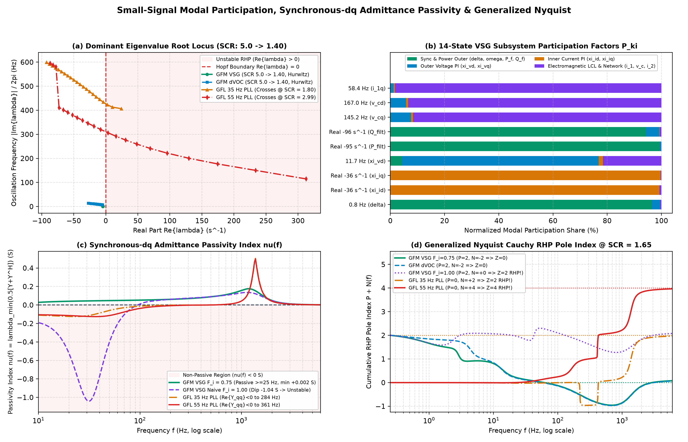
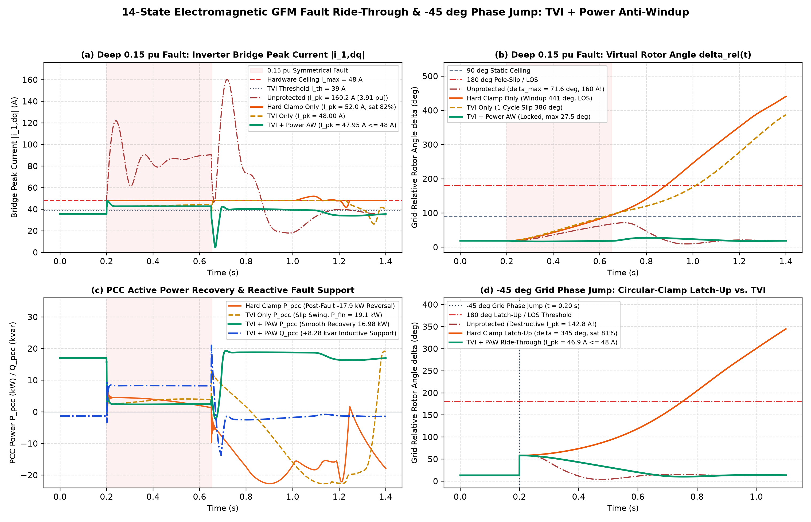
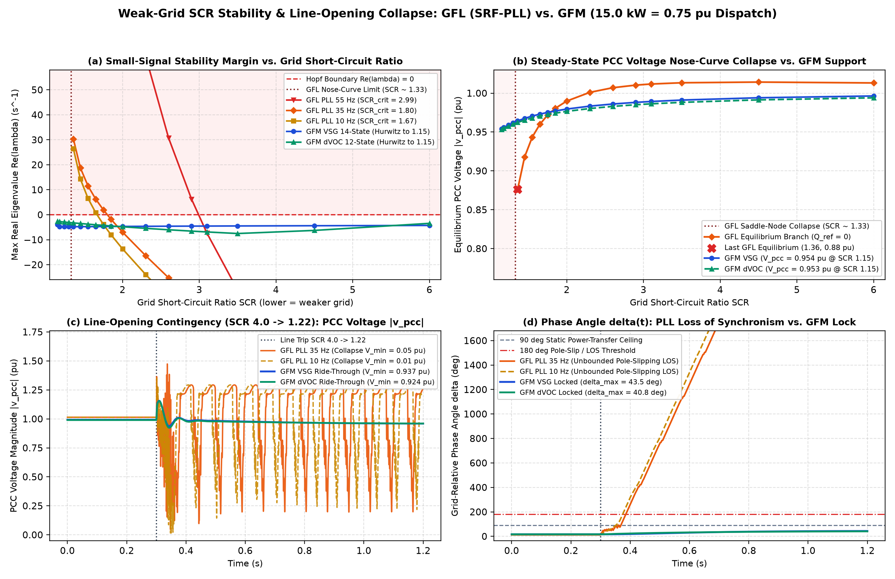
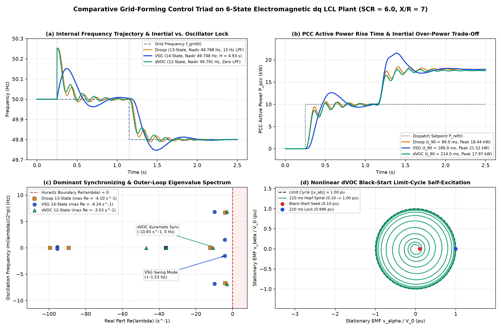
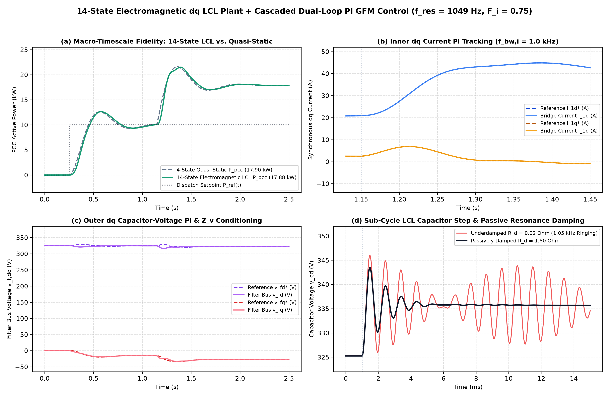
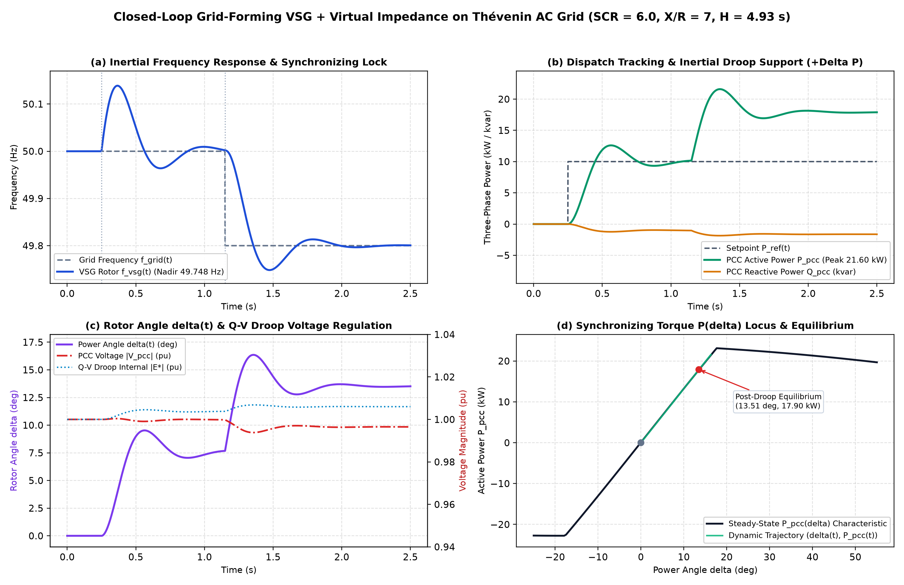

# Grid-Forming Inverter Control & Thévenin Network Dynamic Solver

[](https://github.com/hariszafar740-lang/inverter-grid-control-solver/actions/workflows/ci.yml)

[](https://hariszafar740-lang.github.io/inverter-grid-control-solver/)

[](https://pypi.org/project/inverter-grid-control-solver/)
[](LICENSE)

Physics-based Python simulation, modal participation, synchronous-dq impedance passivity verification framework (`gfm_solver` / `gfm-sim`).
And **[Zero-CDN Interactive HTML5/Canvas Workbench](https://hariszafar740-lang.github.io/inverter-grid-control-solver/)** for Grid-Forming (GFM) and Grid-Following (GFL) Inverter Control:

I care most about the eigenvalue picture here, and the gains probably mean little until you know what the averaged bridge leaves out.

- Zero-CDN Interactive HTML5/Canvas GFM & Weak-Grid Workbench (`src/web_dashboard.py`, `gfm-sim web`): Self-contained offline/GitHub Pages engineering workbench combining a real-time browser 4th-order Runge-Kutta (`dt = 250 us`) electromagnetic fault & weak-grid simulator (`VSG`, `Droop`, `dVOC`, `SRF-PLL`; `TVI + PAW`, `Hard Clamp`, `Unprotected`) with live Python state-space root-locus.
- Passivity ν(f), Generalized Nyquist Z = P + N, and one-click CSV trace export.
- Small-Signal Eigenvalue Participation, Synchronous-dq Admittance Passivity & Generalized Nyquist (`src/small_signal_impedance.py`, `src/cli.py`): Decomposes right/left state-space eigenvectors into exact normalized participation matrices P(ki).
- It derives the exact 2×2 synchronous-dq PCC input admittance Y_(inv,dq)(s) satisfying the Schur-complement pole identity det(I(2) + Z_(g,dq)(λ(i))Y_(inv,dq)(λ(i))) = 0.
- It proves why Qoria partial feedforward (F(i) = 0.75) maintains medium/high-frequency passivity (ν(f) > 0 across [25.
- 6000] Hz) whereas naive F(i) = 1.00 induces a non-passive dip (ν = -1.04 S on [25.1.
- 93.3] Hz), and verifies exact Generalized Nyquist RHP pole counts Z = P + N ≡ Z(ss) across `VSG`, `Droop`, `dVOC`, and `GFL`.
- 14-State Electromagnetic Fault Ride-Through (`FRT`), `-45 deg` Phase Jump.
- Threshold Transient Virtual Impedance (`TVI`) & Power Anti-Windup (`src/transient_virtual_impedance.py`, `src/em_frt_benchmark.py`): Contrasts unprotected overcurrent spikes (`160.2 A = 3.91 pu`).
- Qoria circular current-limiter latch-up & virtual-rotor windup (`440.7 deg` under a `0.15 pu` sag; `344.7 deg` under a `-45 deg` phase jump).
- And coordinated `TVI + Synchronizing Power-Loop Anti-Windup` (`PAW`) (`|i_(1,dq)| <= 47.95 A <= I_max`, `0.1%` voltage-loop saturation, `max delta = 27.5 deg`, zero cycle slips).
- Weak-Grid `SCR` Collapse Benchmark, `GFL (SRF-PLL)` vs. `GFM` (`src/gfl_pll.py`, `src/weak_grid_benchmark.py`): Quantifies bandwidth-dependent PLL–impedance Hopf bifurcation (SCR_crit(f_(bw,pll)) = 2.99 / 1.80 / 1.67) and static nose-curve saddle-node Loss of Synchronism (`LOS`) during parallel-line opening (`SCR: 4.0 -> 1.22`).
- Comparative GFM Control Triad & 14-State Synchronous-dq LCL Plant (`src/gfm_triad.py`, `src/dvoc_control.py`, `src/lcl_plant.py`, `src/cascaded_control.py`): Evaluates 13-State Multi-Loop Droop.
- 14-State `VSG`, and 12-State Nonlinear Andronov-Hopf `dVOC` with black-start limit-cycle self-excitation alongside the 4-state Thévenin baseline and fail-closed algebraic FRT CLI.













## Quick Start & `gfm-sim` CLI

Python `3.10–3.13` is supported and tested in CI as a PEP 621 / PEP 561 typed package (`gfm_solver`):

```bash
python -m pip install -e ".[dev]"
gfm-sim info --json
gfm-sim impedance --scr 1.65 --p-kw 15.0
gfm-sim web --output-dir site --json
python main.py
python -m src.benchmark
python -m pytest -v
```

All CLI subcommands (`gfm-sim info`, `gfm-sim triad`, `gfm-sim weak-grid`, `gfm-sim frt`, `gfm-sim impedance`, `gfm-sim web`, or `python -m gfm_solver <subcommand>`) support `--json` structured output.

## Small-Signal `dq` Admittance Passivity & Generalized Nyquist Summary (`SCR = 1.65`, P(ref) = 15 kW)

Cutting the coupled converter–network loop at the PCC in the synchronous grid dq frame (Δi_(in,dq)^g = Y_(inv,dq)(s)Δv_(pcc,dq)^g) yields exact equivalence between frequency-domain Cauchy winding (Z(nyq) = P + N) and coupled state-space eigenvalues (Z(ss)):

| Converter Architecture | Passivity min_(f ≥25 Hz) ν(f) | Non-Passive Band (≥25 Hz) | Negative Re{Y(qq)} Band | Stiff-Bus RHP P | Nyquist Winding N | Closed-Loop RHP Z = P + N |
|:--- |:---: |:---: |:---: |:---: |:---: |:---: |
| `GFM VSG` (Qoria F(i) = 0.75) | `+0.0019 S` | None (Passive) | `[1.0, 3.3] Hz` | `2` | `-2` | `0` (Hurwitz Stable) |
| `GFM VSG` (Naive F(i) = 1.00) | `-1.0415 S` | `[25.1, 93.3] Hz` | `[1.0, 89.6] Hz` | `2` | `0` | `2` (`42 Hz` Unstable!) |
| `GFM dVOC` (Andronov-Hopf) | `+0.0019 S` | None (Passive) | `[1.0, 6.5] Hz` | `2` | `-2` | `0` (Hurwitz Stable) |
| `GFM Droop` (`13`-State) | `+0.0019 S` | None (Passive) | `[1.0, 7.2] Hz` | `2` | `-2` | `0` (Hurwitz Stable) |
| `GFL SRF-PLL` (`10 Hz`) | `-0.0168 S` | `[25.1, 479.6] Hz` | `[1.0, 19.7] Hz` | `0` | `+2` | `2` (Unstable Hopf) |
| `GFL SRF-PLL` (`35 Hz`) | `-0.1243 S` | `[25.1, 479.6] Hz` | `[1.0, 283.6] Hz` | `0` | `+2` | `2` (Unstable Hopf) |
| `GFL SRF-PLL` (`55 Hz`) | `-0.1259 S` | `[25.1, 479.6] Hz` | `[1.0, 361.4] Hz` | `0` | `+4` | `4` (2 Unstable Pairs) |

## 14-State Electromagnetic `FRT` & `-45 deg` Grid Phase-Jump Summary (`20 kVA`, `SCR = 4.0`, I(max) = 48.0 A)

| Contingency & Protection Mode | Peak Bridge |i_(1,dq)| | Max |δ_rel(t)| | Voltage-Loop Sat. Duty | Fault / Event Q̄_pcc | Post-Event P(pcc) | Ride-Through |
|:--- |:---: |:---: |:---: |:---: |:---: |:---: |
| `0.15 pu` Sag, Unprotected | `160.23 A` (`3.91 pu`) | `71.6 deg` | `0.0%` | `+26.53 kvar` | `16.69 kW` | Fail (Overcurrent) |
| `0.15 pu` Sag, Hard Clamp Only | `52.01 A` | `440.7 deg` | `81.7%` | `+4.87 kvar` | `-17.87 kW` | Fail (Windup `LOS`) |
| `0.15 pu` Sag, `TVI` Only | `48.00 A` | `386.5 deg` | `40.6%` | `+6.75 kvar` | `19.08 kW` | Fail (`1` Cycle Slip) |
| `0.15 pu` Sag, `TVI + Power AW` | `47.95 A` (`<= 48 A`) | `27.5 deg` | `0.1%` | `+8.28 kvar` | `16.98 kW` | Pass (Zero Slips) |
| `-45 deg` Jump, Hard Clamp Only | `51.40 A` | `344.7 deg` | `81.5%` | `-16.09 kvar` | `-15.62 kW` | Fail (Qoria Latch-Up) |
| `-45 deg` Jump, `TVI + Power AW` | `46.86 A` (`<= 48 A`) | `58.2 deg` | `0.0%` | `-7.37 kvar` | `12.21 kW` | Pass (Zero Slips) |

## Weak-Grid `SCR` Collapse & GFM Triad Summary (`20 kVA`, `X/R = 7.0`)

- Weak-Grid `GFL` vs. `GFM` (P(ref) = 15 kW): `GFL SRF-PLL` (`55 / 35 / 10 Hz`) exhibits Hopf instability at SCR_crit = 2.99 / 1.80 / 1.67 and static nose collapse below SCR ≈1.33.
- Whereas `VSG` (maxRe(λ) = -3.97 s^(-1)) and `dVOC` (-2.65 s^(-1)) remain Hurwitz down to SCR = 1.15 and ride through `SCR 4.0 -> 1.22` line opening without `LOS`.
- Comparative GFM Control Triad (`SCR = 6.0`): `Droop` (`13` states, t(90) = 99.0 ms, peak 18.44 kW), `VSG` (`14` states, t(90) = 189.0 ms.
- Peak 21.52 kW, nadir 49.748 Hz), and `dVOC` (`12` states, t(90) = 214.0 ms, peak 17.97 kW, exact Bernoulli black-start self-excitation).

## Governing Equations

### 1. Modal Participation, Synchronous-dq Input Admittance & Generalized Nyquist (`src/small_signal_impedance.py`)

For right/left eigenvectors Av_i = λ(iv)_i and w(i)^ᵀ A = λ(i) w(i)^ᵀ, state k's participation in mode i is P(ki) = |w(kiv)_ki| / Σ_m |w(miv)_mi|.
Linearizing the stiff-PCC converter realization (A(0), B(0), C(0)) around the loaded PCC operating point gives:

~~~
Y_(inv,dq)(s) = C_0(sI - A_0)^(-1)B_0, ν(ω) = λ_min(1/2[Y_(inv,dq)(jω) + Y_(inv,dq)^H(jω)]), det(I_2 + Z_(g,dq)(λ_i)Y_(inv,dq)(λ_i)) = 0
~~~

### 2. Threshold `TVI` & Synchronizing Power Anti-Windup (`src/transient_virtual_impedance.py`)

~~~
ΔR_v(|i|) = k_tvimax(0, |i| - I_th), ΔX_v(|i|, ω) = σ_XRω/ω_0ΔR_v(|i|), P_(ref,eff) = P_ref·Φ_v(V_pcc) - K_awmax(0, |i| - I_th)
~~~

## Scope & Engineering Limitations

This repository models balanced three-phase (positive-sequence) averaged inverter bridge modulation, LCL filter electromagnetics, cascaded dq / `SRF-PLL` / `TVI` control loops, small-signal dq terminal admittances, and Thévenin AC grid equivalents.
In `v1.0.0`, discrete PWM switching ripple, dead-time distortion, semiconductor junction thermal limits, DC-link capacitor energy balance, and unbalanced negative/zero-sequence faults are not modeled.
Passing tests and benchmarks verify **mathematical and software consistency for the documented models only**, they are not evidence of real-hardware performance, grid-code compliance, or equipment certification.

## Citation

Machine-readable citation metadata is provided in [`CITATION.cff`](CITATION.cff) under the [MIT License](LICENSE).
